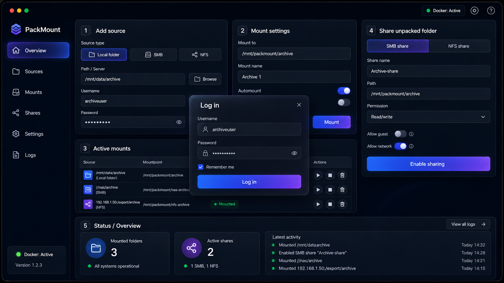

# PackMount 1.3.0

PackMount is a Linux/Docker web UI for presenting RAR archive contents with `rar2fs`, mounting local/SMB/NFS source folders, and exporting mounted views through Samba or NFS. Archives are accessed on demand, **not permanently extracted**.



## Prerequisites and security

- **Linux Docker Engine** with Docker Compose v2; `/dev/fuse` must exist. Host kernel must support FUSE, CIFS, NFS client and NFS server as applicable.
- **Privileged container.** Mounting and kernel NFS require powerful host privileges. Run only on a dedicated/trusted Docker host. Avoid exposing the web UI to the internet.
- **Ports:** TCP 8080 for UI; TCP 139/445 for SMB; TCP/UDP 111, 2049, 20048 for NFSv3-style services. Expose only the services you need, and firewall access to trusted subnets. Note that NFS kernel services and port publishing may depend on host configuration.
- Compose uses Docker bridge networking. FUSE propagation and kernel NFS export accessibility can differ by host; **NFS exports are not guaranteed to work behind Docker bridge/NAT**. For NFS production deployment, verify the host kernel, network topology and firewall before use.

## Install host dependencies with the helper script

The optional `scripts/install-dependencies.sh` helper installs or verifies Docker Engine, Docker Compose v2, FUSE3, CIFS/NFS client utilities, kernel-module tools and basic utilities. It supports Ubuntu/Debian, Fedora/RHEL-family and Alpine Linux. Run it **on the Linux Docker host**, not inside the PackMount container.

```bash
git clone https://github.com/dosenthegit/PackMount.git packmount
cd packmount
chmod +x scripts/install-dependencies.sh
sudo ./scripts/install-dependencies.sh --check-only  # read-only checks first
sudo ./scripts/install-dependencies.sh               # install prerequisites
sudo ./scripts/install-dependencies.sh --check-only  # verify ports and FUSE
```

`--check-only` **does not install packages or modify services**. The default installation enables Docker but never stops `rpcbind`, creates mount propagation, opens firewall ports, or deploys PackMount. Package installation may itself enable `rpcbind`, so recheck ports afterward. `--help` shows the supported options.

### Port 111 or 2049 already in use?

PackMount's optional NFS service may conflict with a host `rpcbind` listener on TCP/UDP **111**, or with an existing NFS server on **2049**. Diagnose before starting Compose:

```bash
sudo ./scripts/install-dependencies.sh --check-only
sudo ss -tulpn | grep -E ':(111|2049)\b' || true
sudo systemctl status rpcbind.socket rpcbind.service  # systemd hosts
```

If this host already uses NFS mounts, NFSv3 or other RPC services, **do not disable `rpcbind`**. Instead, consider running PackMount on a dedicated host or disabling PackMount NFS (`PACKMOUNT_ENABLE_NFSD=false`) **and removing the unused NFS port mappings from the Compose file**. Changing the environment variable alone does not release published ports.

Only on a host that does **not** depend on RPC/NFS services, you may explicitly ask the installer to disable host `rpcbind`:

```bash
sudo ./scripts/install-dependencies.sh --disable-host-rpcbind
sudo ./scripts/install-dependencies.sh --check-only
```

That option checks for common host NFS mounts/server configuration and asks you to type `DISABLE` before stopping/disabling the systemd `rpcbind` socket and service. Its checks cannot detect every RPC dependency; assess your host before proceeding. The option is only supported on systemd hosts and is **never** performed during a normal installation. It also installs/verifies dependencies as part of that run.

If `/dev/fuse` is missing, check kernel support and whether an outer hypervisor/LXC environment permits FUSE. The script cannot grant missing host/container permissions. Review [Operations guide](docs/OPERATIONS.md) for mount propagation and operational considerations.

## Installation (build from GitHub source)

On a **Linux Docker host** (not Docker Desktop), install prerequisites with the helper above or manually. Confirm that `/dev/fuse` exists and host FUSE/CIFS/NFS features required by your use case are available.

```bash
# Skip these first two lines if you already cloned the repository above.
git clone https://github.com/dosenthegit/PackMount.git packmount
cd packmount
cp .env.example .env
nano .env
# Set distinct, strong PACKMOUNT_PASSWORD and PACKMOUNT_SMB_PASSWORD.
mkdir -p config data mounts
# rshared propagation: make each path a mountpoint before setting propagation.
# Only run this after reviewing mounts on the host.
sudo mount --bind "$(pwd)/mounts" "$(pwd)/mounts"
sudo mount --make-rshared "$(pwd)/mounts"
sudo mount --bind "$(pwd)/data" "$(pwd)/data"
sudo mount --make-rshared "$(pwd)/data"
findmnt -T "$(pwd)/mounts" -o TARGET,PROPAGATION
findmnt -T "$(pwd)/data" -o TARGET,PROPAGATION
docker compose config
docker compose up -d --build
docker compose ps
curl -fsS http://127.0.0.1:8080/api/health
```

For mount propagation, **these bind mounts are not persistent across reboot**. Arrange persistent mount points/propagation as described in [Operations guide](docs/OPERATIONS.md) before relying on automatic restart. Avoid blindly adding duplicate bind mounts if these paths are already dedicated shared mounts. The container needs the host's `/dev/fuse`, and ports 8080/139/445/111/2049/20048 must not conflict with other services. NFS exports may not work through Docker bridge networking on every host.

Restrict the management UI and file-sharing ports with the host firewall. Open `http://HOST_IP:8080` and sign in using the credentials set in `.env`. If behind an HTTPS reverse proxy, set `PACKMOUNT_SECURE_COOKIE=true` and test the login flow.

### Install using a published image instead of building locally

After cloning, preparing `.env`, making the directories and arranging mount propagation as above, set `PACKMOUNT_IMAGE=d0sn/packmount:1.3.0` in `.env` for the Docker Hub image (or select a suitable published GHCR image). Then:

```bash
docker compose -f docker-compose.ghcr.yml config
docker compose -f docker-compose.ghcr.yml pull
docker compose -f docker-compose.ghcr.yml up -d --no-build
docker compose -f docker-compose.ghcr.yml ps
curl -fsS http://127.0.0.1:8080/api/health
```

Published images must be accessible to the host; use a versioned tag when possible instead of `latest`. The historic filename `docker-compose.ghcr.yml` can also be used for Docker Hub images.

## Add an archive source

In the UI select **Add source**. For local folders use a path under `/data`, e.g. `/data/archive`; for SMB use `//nas/share`; for NFS use `192.168.1.10:/exports/archive`. Set **Mount to** to an immediate subdirectory of `/mnt/packmount`, e.g. `/mnt/packmount/archive`. Choose whether to start automatically on application startup and whether the source should be read only. Click **Mount**. Local host data under `./data` appears as `/data` inside the container.

To re-share, select a registered mount in the UI, then create a share. When guest access is disabled, Samba authenticates with `PACKMOUNT_SMB_USER` and `PACKMOUNT_SMB_PASSWORD`. NFS `Allowed clients` accepts client IPs, CIDRs and DNS names; use a restrictive subnet, e.g. `192.168.1.0/24`, rather than `*`. NFS exports use `root_squash` by default.

SMB client example: `\\HOST_IP\archive` on Windows, or `smb://HOST_IP/archive` on Linux/macOS (substitute the configured share name).

NFS clients use the path exposed by the host's NFS server; test using `showmount -e HOST_IP` before attempting `sudo mount -t nfs HOST_IP:/mnt/packmount/archive /mnt/test`. NFS is host-dependent and may require a different network deployment.

## Configuration

| Environment variable | Description |
| --- | --- |
| `PACKMOUNT_USER` | Web username (default `admin`) |
| `PACKMOUNT_PASSWORD` | **Required unique** web password |
| `PACKMOUNT_SMB_USER` | Samba user (default `packmount`) |
| `PACKMOUNT_SMB_PASSWORD` | **Required unique** Samba password |
| `PACKMOUNT_SMB_WORKGROUP` | Samba workgroup (default `WORKGROUP`) |
| `PACKMOUNT_SECURE_COOKIE` | Set `true` behind HTTPS proxy |
| `PACKMOUNT_SESSION_MAX_AGE` | Web cookie max age in seconds |
| `PACKMOUNT_ENABLE_SAMBA` | Start Samba daemons (`true` by default) |
| `PACKMOUNT_ENABLE_NFSD` | Start NFS daemons (`true` by default) |
| `PACKMOUNT_NFSD_THREADS` | Kernel NFS worker count (default 8) |
| `PACKMOUNT_MOUNTD_PORT` | mountd port (default 20048) |
| `PACKMOUNT_ALLOWED_LOCAL_ROOTS` | Allowed local folder roots (default `/data,/mnt,/media`) |

You can disable unneeded services in `.env`, **and remove their published ports** in Compose. Database and secrets live in `/config`.

## Upgrade from 1.2.3 or earlier

**Back up the entire `config` directory**, including SQLite WAL/SHM files and `fernet.key`, after stopping the container. Preserve the same Compose bind mounts. Then deploy this version and rebuild. See [Operations guide](docs/OPERATIONS.md) for commands and rollback. The database schema stays compatible. Existing shares using root privileges may behave differently because newly generated Samba configurations no longer use `force user = root`, and NFS now defaults to `root_squash`. Review filesystem ownership and client access after upgrading.

## Troubleshooting

```bash
docker compose ps
docker compose logs --tail=200 packmount
docker compose exec packmount testparm -s
docker compose exec packmount exportfs -v
docker compose exec packmount mount
```

See [Operations guide](docs/OPERATIONS.md) and [Changes](CHANGELOG.md).

## Important limitations

The container needs elevated privileges and cannot sandbox malicious paths as strongly as an unprivileged service. Local source and export configuration should only be given to trusted admins. `rar2fs` doesn't manage encrypted archive passwords in the UI. Passwords for remote SMB mounts are encrypted in SQLite, but the Fernet key is **stored in `/config` on the same host**; secure and back up that directory.

This release is statically validated but **not integration-tested with actual FUSE/NFS/SMB mounts in Docker**.
